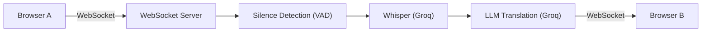

# Vija – Real-Time Bidirectional Speech Translation (Vietnamese ⇄ Japanese)

Real-time bidirectional speech translation system (Vietnamese ⇄ Japanese) between two client devices over WebSocket, featuring energy-based Voice Activity Detection (VAD), Whisper speech recognition (Groq), and context-aware LLM translation (Groq / Gemini) with low latency.



<!-- TODO: Add actual demo image or GIF to docs/demo.gif

-->

---

## Getting Started (3 Steps)

1. **Install dependencies:**
   ```bash
   pip install -r requirements.txt
   ```
   *(To use Gemini as an alternate provider, also install: `pip install -r requirements-gemini.txt`)*

2. **Configure environment:**
   Copy `.env.example` to `.env` and fill in your `GROQ_API_KEY` (available for free at [console.groq.com](https://console.groq.com)):
   ```bash
   copy .env.example .env    # Linux/macOS: cp .env.example .env
   ```

3. **Start the server:**
   - On Windows: Double-click `run.bat` (or run `.\run.ps1` in PowerShell).
   - Manual command:
     ```bash
     python -m uvicorn app.main:app --host 0.0.0.0 --port 8000
     ```
   - Open browser at: `http://localhost:8000` (use Cloudflare Tunnel `.\cloudflared.exe tunnel --url http://localhost:8000` to test across mobile devices).

---

## Configuration Reference (.env)

| Environment Variable | Default | Description |
| :--- | :--- | :--- |
| `GROQ_API_KEY` | *(Required)* | Groq API key for Whisper ASR and LLM MT |
| `GEMINI_API_KEY` | *(Optional)* | Google Gemini API key (optional when using Gemini provider) |
| `ASR_PROVIDER` | `groq` | Speech recognition provider (`groq` / `gemini`) |
| `MT_PROVIDER` | `groq` | Translation provider (`groq` / `gemini`) |
| `MT_FALLBACK` | `none` | Fallback translator if primary service fails or times out (`none` / `groq` / `gemini`) |
| `TONE` | `auto` | Translation tone: `auto` (preserves original nuance), `polite` (polite style, です/ます), `casual` (informal style) |
| `ACCESS_PASSWORD` | *(Empty)* | Room access password; logs a warning on startup if left empty |
| `TRUST_PROXY` | `0` | Set to `1` behind Cloudflare Tunnel / Reverse Proxy to read client IP correctly |
| `AUDIO_PER_MIN` | `15` | Maximum number of voice segments allowed per minute per user |
| `MAX_AUDIO_S` | `30` | Maximum recording duration per utterance (seconds) |
| `MIN_SPEECH_DBFS`| `-48` | Minimum audio energy threshold (dBFS) for speech activity detection |

---

## Benchmark Results

### Two-Way Latency
Measured via `bench.py` using Whisper ASR (`whisper-large-v3`) and LLM translation (`openai/gpt-oss-120b` per `GROQ_MT_MODEL`):

| Direction | ASR (median / p90) | MT (median / p90) | End-to-End (median / p90) | Notes |
| :--- | :---: | :---: | :---: | :--- |
| **Vietnamese → Japanese** | 406 / 503 ms | 661 / 845 ms | 1.1 / 1.4 s | n = 20 clips |
| **Japanese → Vietnamese** | 350 / 384 ms | 541 / 769 ms | 0.9 / 1.1 s | n = 20 clips |

*(Note: Evaluated on n = 20 clips per direction cut from public videos and tested manually. Several Japanese audio clips are very short, resulting in lower transcription and translation times).*

### Recognition Accuracy (WER / CER)

| Language | Metric | Whisper (Groq) | Notes |
| :--- | :---: | :---: | :--- |
| **Vietnamese** (`refs_vi.json`) | WER | 9.4% | n = 5 clips with ground truth references |
| **Japanese** (`refs_ja.json`) | CER | Not measured | n = 20 clips without reference transcripts |

*Note: Translation quality has not been evaluated by native speakers.*

---

## Test Data

- **Data Source:** Audio clips were sampled from public videos for private testing and are excluded from the repository (enforced via `.gitignore`).
- **Latency Variability:** Clip durations vary, so latency figures are intended for general reference.
- **Metric Evaluation:** WER/CER accuracy scores are calculated solely for clips with valid ground truth references (clips with empty string `""` in reference files bypass error calculations and record timing only).

---

## Known Limitations

- **Hands-Free Mode:** Integrated AudioWorklet + VAD automatically segments utterances after ~0.8 s of silence. Using headphones is strongly recommended to prevent microphone acoustic feedback from device speakers.
- **No Text Streaming:** Translated text is delivered in full once LLM generation finishes; token-by-token streaming is currently not supported.
- **No Chunked Audio Streaming:** Voice segments are transmitted upon utterance completion rather than streamed incrementally.
- **Groq Free-Tier Rate Limits:** The Groq free tier enforces RPM limits (20 requests/minute for Whisper); automated benchmarks should use pacing pauses between requests.
- **iOS Safari Support:** Requires further testing regarding MediaStream AudioContext permission constraints in newer iOS Safari versions.
